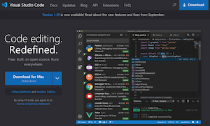

# Chapter One - Containers with Docker and Podman

> ⚠️ **Not yet hardware-verified.** The commands and screenshots in this chapter were drafted from documentation and are pending a validation pass on a real Raspberry Pi bench. See `docs/video/HARDWARE-VERIFICATION.md`.

## Introduction to containers

Docker and Podman are container engines ... which means that they run "containerized" applications, or programs.  Containerized applications, or just *containers*, are the smallest and simplest way to run one or more programs in an isolated context.  This method of creating images allows you to run programs, along with all of their dependencies, without needing to install the programs on your computer, or even in the same operating system as the one installed on your computer.

Containers are made of one or more images layered on top of each other.  This layering allows you to keep the operating system separated from dependencies separated from the application.  This layering also speeds up the process of building containers, and allows you to re-use images in multiple containers.

Container images can be stored in, and downloaded from, registries.  The most popular free registry is Docker Hub, and both Docker and Podman can pull from and push to it (or any other OCI-compliant registry).

## Basic container commands

We're going to tell the engine to download (if you don't already have it) the latest version of the Ubuntu container for your computer's architecture and to connect to it in the `bash` shell as the `root` user.

``` bash
# Docker
docker run -it ubuntu /bin/bash
# Podman — identical flags, same OCI image, no rebuild
podman run -it ubuntu /bin/bash
```

My computer displayed the following: 

```
Unable to find image 'ubuntu:latest' locally
latest: Pulling from library/ubuntu
22e816666fd6: Pull complete
079b6d2a1e53: Pull complete
11048ebae908: Pull complete
c58094023a2e: Pull complete
Digest: sha256:a7b8b7b33e44b123d7f997bd4d3d0a59fafc63e203d17efedf09ff3f6f516152
Status: Downloaded newer image for ubuntu:latest
root@01970526c47f:/#
```

That last line that ended with the "hash" or "pound" character indicates that you're in the Ubuntu operating system running as the root user.  To show that you're in there, try a few commands like `ls` to list the contents of the folder, then `exit` when you're done.  In this case, exiting will take you out of the Ubuntu container and terminate it.  The Ubuntu image is cached on your computer, so it will not need to be re-downloaded when we run it again.

To see the running containers, ask the engine for its process list:

``` bash
# Docker
docker ps
# Podman
podman ps
```

You should see the column headers, but no information displayed.  Now let's start up the Ubuntu container again, but this time "detached" from your display:

``` bash
# Docker
docker run -itd ubuntu
# Podman
podman run -itd ubuntu
```

The string of characters it prints on the screen will be the container ID.  You can confirm this, and see that it is running, by printing the running containers again (`docker ps` / `podman ps`).  Notice that the container ID it lists is an abbreviation - or shortened version - of the full container ID.  You can refer to a container by the first few characters of the ID as long as it's unique.

To see just the list of running container IDs, try using the "quiet" flag:

``` bash
# Docker
docker ps -q
# Podman
podman ps -q
```

To connect to the running container, use the attach command with the ID you just saw, and you will be back in the shell.  Remember to type "exit" to leave the container, which will also stop it.

``` bash
# Docker
docker attach <ID>
# Podman
podman attach <ID>
```

To see all containers on your computer, no matter whether they are running or in any other state, print them all:

``` bash
# Docker
docker ps -a
# Podman
podman ps -a
```

To remove a container from your computer, use the remove command with its ID:

``` bash
# Docker
docker rm <ID>
# Podman
podman rm <ID>
```

And let's put the commands together and tell the engine to remove all containers on your computer:

``` bash
# Docker
docker rm $(docker ps -aq)
# Podman
podman rm $(podman ps -aq)
```

Last, let's list all of the images that have been downloaded:

``` bash
# Docker
docker images
# Podman
podman images
```

To see just a list of the image IDs, add the quiet flag (`docker images -q` / `podman images -q`).  To remove an image, use the remove-image command:

``` bash
# Docker
docker rmi <ID>
# Podman
podman rmi <ID>
```

And to remove all images, put them together:

``` bash
# Docker
docker rmi $(docker images -q)
# Podman
podman rmi $(podman images -q)
```

*Why?*

Docker and Podman implement the same CLI surface and run the same [OCI](https://opencontainers.org) images, so this book teaches "a container engine" and you pick either one.  Podman is daemonless and rootless by default, which fits a headless Raspberry Pi nicely; Docker ships Docker Desktop and has the larger ecosystem and third-party tooling.  Every command above is the same except for the program name - so from here on the book just says "your container engine (Docker or Podman)".

## Create a simple Dockerfile



Choose an editor to create a text file named `Dockerfile`.  Podman also reads this file when it is named `Containerfile` - the two names are interchangeable and the contents are identical, so use whichever you prefer.  I prefer Microsoft's [Visual Studio Code](https://code.visualstudio.com).  You will also want [Docker Desktop](https://www.docker.com/products/docker-desktop) (or, for Podman, [Podman Desktop](https://podman-desktop.io)) if you plan to build and test on a machine other than the Raspberry Pi.  If you want to save images rather than building them every time, [create an account on a registry](https://hub.docker.com/signup) such as Docker Hub and use it as your image repository - Podman pushes to the same registries Docker does.

## Build the image

``` bash
# Docker
docker build ./
# Podman
podman build ./
```

## Next

On to [chapter two](https://github.com/joe-diy/DIY-EdgeComputing/tree/master/CH02%20-%20Open%20Horizon%20Fundamentals#chapter-two---open-horizon-fundamentals), where one command turns this Pi into a managed fleet node.
